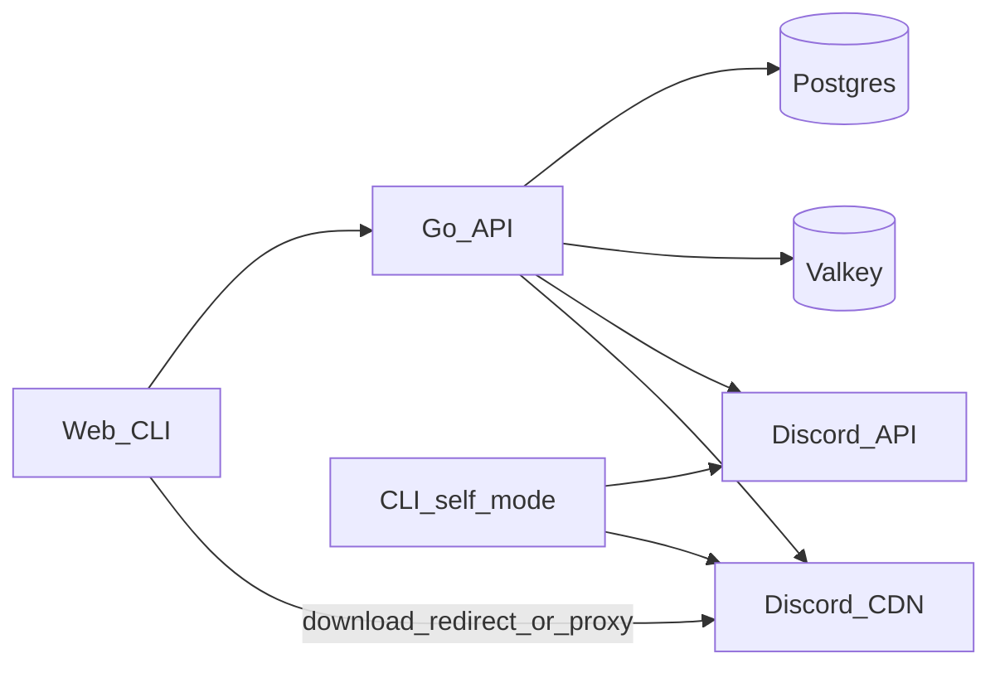

# DisCloud

[](https://github.com/mewisme/discloud-go/actions/workflows/ci.yml) [](https://github.com/mewisme/discloud-go/actions/workflows/release.yml) [](go.mod) [](https://github.com/mewisme/discloud-go/releases/latest) [](https://github.com/mewisme/discloud-go/pkgs/container/discloud) [](LICENSE)

Self-hosted file host that stores files as Discord attachments (fixed **8 MiB** chunks), with a **Postgres** index, **Valkey** for CDN URL cache and rate/quota counters, a **Go API**, a **Next.js** UI, and a **`discloud` CLI**. The CLI also supports **self-managed** mode: upload/download straight to Discord with portable `.discloud` bundles (no API required for transfer).

## Features

- Content-addressed chunks and resumable upload sessions (web IndexedDB + CLI checkpoints)
- **Self-managed** CLI mode: multi-file `.discloud` bundles, password or obfuscated protection, guild-tier chunk sizing, identity checks on download
- Interactive CLI pickers (`upload pick` / `get pick`), progress bars, folder walk with `--depth`
- CLI **customize**: progress-bar gradients + longHue, huh prompt themes, left/center align (banner + tables)
- Public/private files, password shares, download limits, access-token rotation (server-managed)
- Cookie sessions and personal API tokens (`dc_…`); first user on a fresh DB is `admin`
- Compose stack: API + web + Postgres 18 + Valkey 8
- CLI via instance `/install.sh` · `/install.ps1`, [get.mewis.me](https://get.mewis.me/discloud.sh), Scoop, or Homebrew

## Architecture



DisCloud uses fixed 8 MiB chunks for broad compatibility with Discord attachment uploads (max 8192 chunks ≈ 64 GiB per file). Self-managed mode sizes chunks from the guild premium tier instead. Details: [docs/architecture.md](docs/architecture.md).

## Quick start

1. Create a Discord bot with **Attach Files** permission and note a channel ID.
2. Configure env:

```bash
cp .env.example .env
# set DISCLOUD_BOT_TOKEN, DISCLOUD_CHANNEL_ID, DISCLOUD_CORS
```

3. Start the stack:

```bash
docker compose up -d
```

| | |
| --- | --- |
| UI | http://localhost:3000 |
| API | http://localhost:6373 |
| Docs | http://localhost:3000/docs |

Images: `ghcr.io/mewisme/discloud` and `ghcr.io/mewisme/discloud-web` (`DISCLOUD_TAG`, default `latest`).

Build from source:

```bash
docker compose -f docker-compose.yml -f docker-compose.build.yml up --build -d
```

## CLI installation

From a running instance (web proxy):

```bash
curl -fsSL http://localhost:3000/install.sh | sh   # macOS / Linux
irm http://localhost:3000/install.ps1 | iex        # Windows
```

Public installer:

```bash
curl -fsSL https://get.mewis.me/discloud.sh | sh   # macOS / Linux
irm https://get.mewis.me/discloud.ps1 | iex        # Windows
```

Or:

```bash
scoop install mew/discloud-cli
brew install --cask discloud-cli
go build -o discloud-cli ./cmd/discloud-cli
```

Install scripts default `base`/`origin` to `http://localhost:6373` and `http://localhost:3000` (override with `DISCLOUD_BASE` / `DISCLOUD_ORIGIN`).

The released command is `discloud`. The API container entrypoint is `/discloud`. Full command tree and shell completion: [docs/cli.md](docs/cli.md).

## Basic usage

Web: open http://localhost:3000 — upload files or folders, manage visibility, copy share links. Account at `/me`; inspect at `/i/<file-id>`; admin at `/admin`.

**Server-managed:**

```bash
discloud config set --base http://localhost:6373 --origin http://localhost:3000
discloud auth login
discloud upload ./file.bin
discloud files list
discloud files share <file-id> --password 'secret-pass' --mode view --max-downloads 10
discloud get <file-id> --password 'secret-pass' --download --out ./downloaded.bin
discloud files verify ./downloaded.bin <sha256>
```

**Self-managed** (Discord bots in `config.yaml`; no API upload path):

```bash
discloud config set self-upload
discloud upload ./file.bin --mode self
discloud get ./file.bin.discloud --out ./downloads
discloud files list ./file.bin.discloud
```

**Customize UI** (progress colors, prompt theme, align):

```bash
discloud config set customize
discloud config set customize --prompt-theme charm --align left
discloud config set customize --upload-colors '#3f51b1,#f18271,#f7c978' --upload-long-hue
```

Whole-file digests use **discloud-sha256-v1** (equals `sha256sum` only for single-chunk files ≤ 8 MiB). See [docs/file-integrity.md](docs/file-integrity.md).

## Operational notes

**Deleting a file from DisCloud does not delete Discord-hosted attachments.** Cancel marks an upload session `cancelled` (row kept); delete/expiry remove Postgres metadata only. Discord lifetime is outside this app.

**Persist `/data`.** If `DISCLOUD_APP_SECRET` is unset, the API writes `.app.secret` (and `.visitor.secret`) under the process cwd — Docker volume `discloud-data` → `/data`. Losing or changing the secret invalidates sessions, file access tokens, and upload resume tokens. Multiple API replicas must share the same durable secret.

**Back up** Postgres (`discloud-pgdata`) and the API data volume. Valkey persistence is disabled on purpose; rate-limit/quota counters reset on restart.

Fuller ops: [docs/operations.md](docs/operations.md). Config: [docs/configuration.md](docs/configuration.md).

## Documentation

| Doc | Contents |
| --- | --- |
| [Architecture](docs/architecture.md) | Domain model, chunking, upload lifecycle, retention |
| [Configuration](docs/configuration.md) | Environment variables and fixed limits |
| [API](docs/api.md) | Routes, auth, uploads, downloads |
| [CLI](docs/cli.md) | Command tree, install, self-managed mode, customize, completion |
| [Security](docs/security.md) | Cookies, tokens, CSRF, secrets |
| [Operations](docs/operations.md) | Compose, backup, reverse proxy, `DISCLOUD_APP_SECRET` |
| [File integrity](docs/file-integrity.md) | `discloud-sha256-v1` construction and verify |

Also: [CONTRIBUTING.md](CONTRIBUTING.md), [SECURITY.md](SECURITY.md), [web/README.md](web/README.md).

## Development

Requires **Go 1.26.3+** (see `go.mod`), Postgres, Valkey, and Discord credentials for a local API.

```bash
cp .env.example .env
make up          # compose stack
make run         # go run ./cmd/discloud
make web-dev     # cd web && pnpm run dev
make test        # go vet + go test
make lint        # gofmt check + web lint/tsc
make build       # dist/discloud + dist/discloud-cli
```

CI (push/PR): gofmt, `go vet`, `go test`, web lint/typecheck/build, Docker image builds.  
Release: tag `v*` → GoReleaser (CLI + GHCR `discloud` / `discloud-web`).

## License

[MIT](LICENSE) · [Code of Conduct](CODE_OF_CONDUCT.md) · [Security](SECURITY.md)
