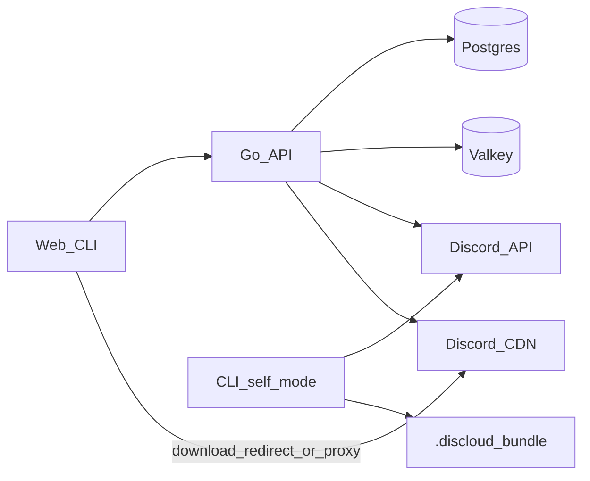

# Architecture

DisCloud keeps metadata, auth, retention, and download URLs in your stack, and stores file bytes as Discord message attachments.

## Components

| Piece | Role |
| --- | --- |
| `cmd/discloud` | HTTP API server (container entrypoint `/discloud`) |
| `cmd/discloud-cli` | Client binary (command name `discloud`) |
| `web/` | Next.js UI |
| `internal/server` | Routes, upload/download, auth gates, cleanup |
| `internal/store` | Postgres / SQLite metadata + migrations |
| `internal/discord` | Discord API v10 attachment uploads |
| `internal/cache` | Valkey: CDN URL cache, rate-limit/quota counters |
| `internal/auth` | Password hashing, HMAC key derivation |
| `internal/client` | Shared HTTP client for the CLI |
| `internal/integrity` | Whole-file digests (`discloud-sha256-v1`) |
| `internal/config` | Environment configuration |
| `internal/appconfig` | Allowlisted public keys, env+DB merge, PremiumTier chunk resolve |
| `internal/transfer` | Chunk size / hashing helpers (API + self-managed) |
| `internal/selfmanaged` | `.discloud` bundles (encode/decode, identity, crypto) |

Server-managed uploads use an **effective** chunk size from guild Premium Tier when a guild ID is configured; otherwise **8 MiB**. Self-managed CLI uploads talk to Discord directly and store retrieval metadata in a local `.discloud` bundle (same tier rules).

## Domain model

Three separate concepts — do not conflate them:

| Concept | What it is | States / values |
| --- | --- | --- |
| **Upload session** | Incomplete upload work in `upload_sessions` | `pending` → `uploading` → `completing` → `completed`, or `cancelled` / `expired`. Not a `files` row. |
| **File resource** | Row in `files` after a successful complete | Share, visibility, expiry, digest, inspect counters live here. |
| **`files.status`** | Upload **result** badge only | `ready` (new assemble) or `reused` (same owner re-completed identical parts). Not a lifecycle; there is no `uploading` on files. |

JSON IDs: file payloads use `fileId`; account and API-token payloads use `id`.

## Storage and chunking

Effective upload chunk size (also returned by `GET /api/info`):

| Guild Premium Tier | Max chunk |
| --- | --- |
| none / unset guild | **8 MiB** (legacy default) |
| 0 or 1 | 10 MiB |
| 2 | 50 MiB |
| 3 | 100 MiB |

| Limit | Value |
| --- | --- |
| Preferred size | Optional (`DISCLOUD_CHUNK_SIZE` / `chunkSize` / DB `chunk_size`); `0` → tier max when guild set |
| Max chunks per file | 8192 |
| Effective max file size | `8192 × effectiveChunkSize` (legacy ≈ 64 GiB at 8 MiB) |

**Where guild / preferred size come from**

| Path | Source |
| --- | --- |
| Docker / Postgres | Env defaults; DB `config` row wins per key; Admin UI / `PUT /api/admin/config` |
| Local SQLite | `server.yaml` `guildId` / `chunkSize` (mapped to env at load) |

Each stored file keeps its own `chunk_size` from upload time; changing the live setting only affects **new** uploads.

### Content addressing

- Each chunk is hashed with SHA-256 and stored in the global `chunk_store` table keyed by hash.
- Re-uploading a known hash skips a new Discord POST (`ON CONFLICT DO NOTHING`).
- Deduplication of **chunk bytes** is therefore **global** (any uploader can reuse an existing hash).
- Reusing an entire **file resource** (`status=reused`) is **owner-scoped**: same owner, same name, same ordered Discord message IDs.

### Discord attachments

- Multiple bot tokens (comma-separated `DISCLOUD_BOT_TOKEN`) rotate round-robin on upload.
- Each chunk maps to one Discord message attachment; `bot_id` records which token uploaded it.
- **Deleting a file resource removes Postgres metadata only.** Discord messages and attachments are never deleted by the app.
- Unused `chunk_store` rows are **not** garbage-collected when files are deleted. The only cleanup of `chunk_store` is when a download discovers that Discord reports the attachment gone (`ErrAttachmentGone`), at which point the matching hash row is dropped so a future upload can re-POST the bytes.

## Upload lifecycle

Preferred path (web + CLI):

1. **Create** — `POST /api/uploads` → `uploadId` + `resumeToken` (status `pending`)
2. **Upload chunks** — `HEAD/GET /api/chunks/{hash}` / `POST /api/chunks` (skip known hashes)
3. **Register parts** — `PUT /api/uploads/{id}/parts/{idx}` or batch `POST …/parts` (moves toward `uploading`)
4. **Complete** — `POST /api/uploads/{id}/complete` (idempotent; creates or reuses a file resource)
5. **Cancel** — `DELETE /api/uploads/{id}` marks the session `cancelled` (**does not delete the row**; does not purge Discord blobs)
6. **Expire** — background cleanup marks open sessions past `expires_at` as `expired`

Resume uses `X-Upload-Token` (or `?token=`) with the resume token. Incomplete uploads are not `files` rows until complete.

Legacy path still works: `POST /api/upload` and `POST /api/upload/complete`.

Upload session TTL: anonymous **24h**, authenticated **48h**. Max open sessions per owner/anon fingerprint: **20**.

## File retention and deletion

| Rule | Value |
| --- | --- |
| Anonymous file retention | 7 days |
| Authenticated file retention | 30 days |
| Extension on full `?download=1` | +7 days (cap: now + 30 days) |
| Extension conditions | `download=1`, not `HEAD`, no `Range` header |
| Expired-file cleanup | Hourly batches (metadata delete only) |
| Upload-session TTL | Anon 24h / auth 48h (status → `expired`) |

**Warning:** Deleting a file from DisCloud (or letting it expire) does **not** delete the corresponding Discord-hosted data. Attachment lifetime is controlled by Discord, not this app.

## Valkey

Valkey is required for readiness and is used for:

- Signed Discord CDN URL cache
- Upload/download rate-limit counters
- Anonymous upload/day and bytes/day quota counters
- Auth attempt throttling

Compose disables AOF/RDB on purpose. After a Valkey restart, CDN URLs rebuild on demand; rate-limit and quota counters reset.

## Web UI surfaces

| Path | Purpose |
| --- | --- |
| `/` | Upload (multi-file, folder, resumable via IndexedDB) |
| `/files` | Owned file management |
| `/i/{id}` | File inspect / share settings |
| `/docs` | In-app HTTP notes |
| `/admin` | Admin overview + Postgres runtime Config editor |
| `/signin`, `/signup` | Auth |
| `/me`, `/me/tokens`, `/me/preferences`, `/me/security` | Account |
